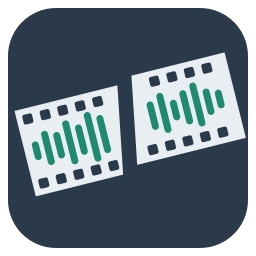

# losslessaudiocut



A lossless audio cutter in Rust: delete parts of a recording, join the rest
or split it into tracks, without ever re-encoding lossy audio.

Status: early development. WAV, AIFF, FLAC, Ogg (Vorbis, Opus, Speex), MP3,
MP4/M4A (AAC, ALAC), raw AAC (ADTS), AC-3 and Matroska/WebM (Opus) cutting work from the command
line and in the wxWidgets GUI (waveform, zoom, select, delete, split into
tracks, undo, export, playback of the result, scrubbing, playback speed, a
track list with per-track tags). See
[`docs/architecture.md`](docs/architecture.md) for the design.

## Install

On Linux, from the Snap Store (development builds on the edge channel
until the first release):

```sh
sudo snap install losslessaudiocut --edge
losslessaudiocut              # the GUI
losslessaudiocut.cli --help   # the command line tool (`lac` below)
```

The snap can open files in your home directory; for USB sticks and other
drives run `sudo snap connect losslessaudiocut:removable-media`. Packaging
and release steps: [`docs/snap.md`](docs/snap.md).

For Windows (zip or installer), macOS (DMG) and Linux (AppImage), download
the package for your system from the
[releases page](https://github.com/gunterkoenigsmann/losslessaudiocut/releases);
see [`docs/release.md`](docs/release.md) for what each contains.

## GUI

```sh
cargo run --bin losslessaudiocut -- recording.mp3
```

The file argument is optional (`--help` and `--version` work too); on macOS
files opened from the Finder arrive as an "open documents" event, which the
program handles the same way. If edits are not exported yet, it asks before
switching to the new file.

Mouse wheel zooms at the pointer, Shift + wheel (or a horizontal wheel)
scrolls; View menu: zoom in (Ctrl++), out (Ctrl+-), to fit (Ctrl+0).

Drag with the left mouse button to select, Shift+click to move the nearer
edge of the selection. Edit menu: delete the selection (Del), restore deleted
parts inside it (Ctrl+R), undo (Ctrl+Z), redo (Ctrl+Y), select all (Ctrl+A)
or nothing (Esc). Deleted parts stay visible, shaded red, so they can be
restored; the export leaves them out. File > Export (Ctrl+E) writes the kept
parts to a new file of the same format without re-encoding; the status bar
then says how much the cuts moved to packet boundaries. A `*` in the title
marks edits that are not exported yet, and closing or opening another file
asks before they are lost.

Ctrl+K starts a new track at the cursor (or the selection start), Ctrl+J
joins the track under the cursor with the one before it, and F2 names it.
Track boundaries show as dashed lines with the track number and name. With
tracks, File > Export asks for a folder and writes one file per track,
`<name>-01 <track name>.<ext>`, `<name>-02.<ext>`, …; a track that is
deleted entirely gets no file. Each file gets the source's tags with its
track number (counting the files written), the number of tracks, and the
track's name as title.

The track list under the waveform (View > Track list, Ctrl+L) shows every
track with the tags its file will get: title, artist, album, album artist,
track number and count, date, genre and comment. Click a cell and type to
change it (the title is the track's name); changed values are shown in
bold blue, and typing the original value back undoes the change. Edit > Use
for all tracks (Ctrl+Shift+A) gives every track the value of the selected
cell, e.g. the album. Selecting a row moves the cursor to that track. Tag
changes are undone with Ctrl+Z like any other edit.

A time ruler along the bottom of the waveform shows the time scale at any
zoom, down to fractions of a millisecond (View > Time ruler switches it
off).

The minimap above the waveform shows the whole recording with deleted parts
shaded, track boundaries and the playhead; a frame marks the part the
waveform window shows. Drag the frame, or click beside it, to go there.

The bar *Selection and clock* shows where the selection starts and ends,
its length, and a large play clock (source time, like the waveform). Type a
time into a field and press Enter to set the selection: a start keeps the
end, an end or a length keeps the start; without a selection, a start moves
the cursor. Times are seconds, `m:ss`, `h:mm:ss` (all with optional
decimals) or `@frames`.

*File > Open recent* lists the last nine files opened; the list is kept
between runs, and a file that no longer exists is taken off it when chosen.

View > Log opens a pane that keeps every message of the status bar with
its time, so a warning that flashed by can be read again.

The toolbar, the minimap, the selection bar, the track list and the log are
dockable panes: drag them by their gripper or title to another edge of the
window, float them, resize or close them; the View menu shows and hides each
one. Their arrangement and the window size are remembered between runs.

While the waveform loads, the file is also searched for pauses (silence or
only noise) and track starts. Suggested pauses show as a strip along the
bottom (teal for silence, amber for noise), suggested track starts as a tick
at the top. *Edit > Split at suggested track starts* (Ctrl+Shift+K) and
*Edit > Delete suggested pauses* (Ctrl+Shift+D) apply them, each as one
undo step.

Space plays and stops. Playback plays what the export will contain: the kept
parts, with the deleted ones skipped, starting at the selection or at the
cursor (a click without dragging puts it; Home moves it to the start).
Clicking while playing jumps there; stopping returns to the cursor.

Dragging with the right mouse button scrubs: playback follows the pointer
in short pieces of unaltered audio, so a word or a note can be found by ear.
Released, playback goes on from there if it was running before; otherwise it
stops and the cursor stays where the scrub ended.

Dragging a selection with the left button scrubs its moving edge too, so a
cut point can be placed by ear (a plain click stays silent). *Play > Scrub
while selecting* switches that off; it and *Keep pitch* are remembered
between runs.

Ctrl+Up and Ctrl+Down play faster or slower (0.5× to 3×), Ctrl+1 returns to
normal speed. By default the pitch stays the same, so speech stays
intelligible when skimming through long recordings; with *Play > Keep pitch*
switched off, the pitch follows the speed like a tape. The speed only
affects listening, never the exported files.

## Command line

```sh
cargo run --bin lac -- info recording.wav
cargo run --bin lac -- cut recording.wav -o out.wav --delete 1:00..1:30 --delete 5:00..
cargo run --bin lac -- cut recording.wav -o out.wav --keep 0:10..3:45
cargo run --bin lac -- cut show.mp3 -o part2.mp3 --keep 30:00.. --tag title="Part 2" --tag track=2
```

Times are seconds (`90.5`), `m:ss`, `h:mm:ss` or `@N` for sample frame N.
`info` shows the tags; `--tag FIELD=VALUE` changes one in the output (title,
artist, album, album_artist, track, tracktotal, date, genre, comment; an
empty value removes it), the others are copied from the input.

Tab completion: `lac completions SHELL` prints a script for bash, zsh, fish,
PowerShell or elvish, e.g.

```sh
lac completions bash > ~/.local/share/bash-completion/completions/lac
lac completions zsh > ~/.zfunc/_lac      # a directory in $fpath
lac completions fish > ~/.config/fish/completions/lac.fish
```

Manpages: `lac manpages DIR` writes `lac.1`, `lac-cut.1` and one page per
command into `DIR` (for packagers; `man -l DIR/lac.1` shows one without
installing).

The packages ship both: the snap's `losslessaudiocut.cli` completes in bash
out of the box, and each release has the manpages and completions as a
tarball (see [docs/release.md](docs/release.md)).

## Development

Building needs the FFmpeg development files (FFmpeg 5.1 or newer: libavcodec,
libavformat, libavutil) and libclang, e.g. `apt install libavcodec-dev
libavformat-dev libavutil-dev clang pkg-config` or `brew install ffmpeg
pkg-config`. Only FFmpeg's decoders are used.

The GUI uses [wxdragon](https://crates.io/crates/wxdragon), which downloads
and builds wxWidgets itself (the first build takes several minutes). It needs
CMake and a C++ compiler everywhere, and on Linux the GTK 3 development files.
Playback uses [cpal](https://crates.io/crates/cpal), which on Linux needs the
ALSA development files (`apt install cmake ninja-build libgtk-3-dev
libasound2-dev`).

```sh
cargo fmt --all -- --check
cargo clippy --workspace --all-targets -- -D warnings
cargo test --workspace
RUSTDOCFLAGS="-D warnings" cargo doc --workspace --no-deps
```

Some tests cross-check results with `ffmpeg`, `flac`, `oggdec`
(vorbis-tools) and `mpg123` if they are installed; set `LAC_REQUIRE_TOOLS=1` to make missing tools an error.
Test fixtures are regenerated with `crates/lac-container/tests/fixtures/generate.sh`. See
[`AGENTS.md`](AGENTS.md) for conventions.

Release packages (Windows zip and installer, macOS DMG, Linux AppImage) are
built by CI when a version tag is pushed; see
[`docs/release.md`](docs/release.md).

## License

GPL-3.0-or-later
