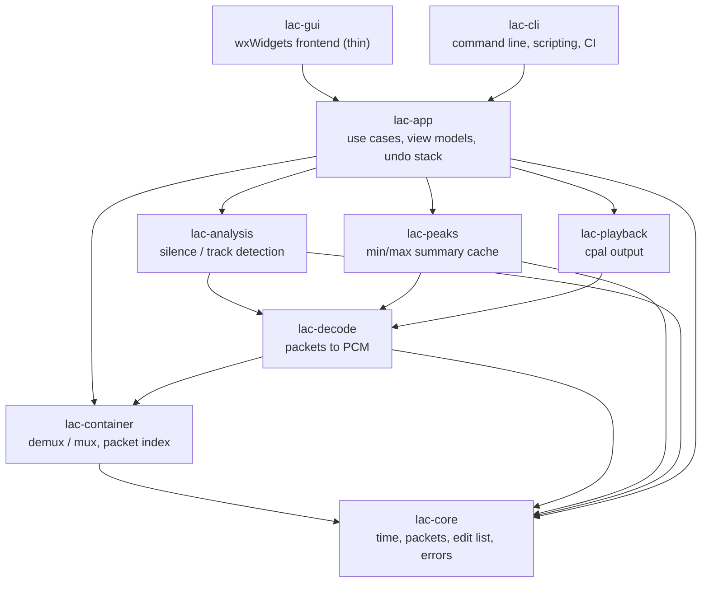

# losslessaudiocut: Architecture Proposal

Status: **draft for discussion**. Open questions are collected in
[section 12](#12-open-questions) and decisions so far in [section 11](#11-decisions-so-far); decisions marked *(proposed)* are
recommendations that still need a yes/no.

## 1. Goals and non-goals

**Goals**

1. Cut recordings in AAC, Speex, Ogg (Vorbis/Opus), MP3, WAV and FLAC
   **without re-encoding lossy audio**. Kept audio is bit-identical to the
   source after decoding.
2. Fast waveform display at every zoom level, from the whole multi-hour
   recording down to individual samples.
3. Playback with a cursor, so cut points can be found by ear.
4. A maintainable, layered architecture where each layer is testable without
   the layers above it, in particular without a GUI.
5. *(Future)* Automatic detection of regions with neither speech nor music
   (candidates for deletion) and of track boundaries (candidates for splits).

**Non-goals (for now)**

- Mixing, effects, gain changes, sample-rate conversion. Anything that
  modifies samples forces a re-encode, which contradicts goal 1.
- Multitrack editing in the DAW sense.

## 2. The central insight: cut packets, not samples

Every supported format stores audio as a sequence of **packets** (MP3/AAC
frames, Vorbis/Opus/Speex packets, FLAC frames, or for WAV arbitrary blocks of
PCM). A lossless cut is a cut that copies whole packets verbatim into a new
container. The hard part is not the copying but three per-codec subtleties:

| Issue | Meaning | Affected codecs |
|---|---|---|
| **Granularity** | A packet is the smallest unit we can keep or drop. | all lossy: MP3 1152, AAC 1024, Vorbis 64..8192 (variable), Opus 120..2880, Speex 160/320/640 samples |
| **Pre-roll / dependency** | A packet cannot be decoded correctly without its predecessor(s) (MDCT overlap, MP3 bit reservoir, LPC state). We must keep N extra packets in front of a cut and tell the decoder to discard their output. | MP3 (bit reservoir, up to ~511 bytes back), AAC, Vorbis, Opus, Speex (state converges after a frame or two) |
| **Trimming metadata** | Some containers can say "decode these packets but drop the first *a* and last *b* samples". This turns packet-granular cuts into sample-exact cuts while still copying packets verbatim. | MP3 (LAME/Xing tag delay/padding), MP4/M4A (edit list `elst`), Ogg (granule positions, Opus `pre_skip`) |

FLAC and WAV are special: they are lossless codecs, so we can re-encode the
two boundary frames (FLAC) or just slice samples (WAV) and still be
**sample-exact and bit-exact**.

From this follows the key domain abstraction:

```rust
/// What a codec/container pair is able to do when cutting.
/// Determined once per opened file; drives UI snapping and export.
pub struct CutCapabilities {
    /// Smallest cut step without trimming metadata (in samples, may vary per packet).
    pub packet_granular: bool,
    /// Packets that must be kept before the first wanted packet.
    pub preroll_packets: u32,
    /// Container can express leading/trailing sample discard.
    pub can_trim_start: bool,
    pub can_trim_end: bool,
    /// Boundary packets may be re-encoded losslessly (FLAC, PCM).
    pub lossless_reencode: bool,
}
```

The UI shows where a cut will *really* land (snapped to packet boundaries
when needed) and export produces an **exactness report** (requested vs.
actual cut position per boundary), so there are no surprises.

## 3. Layered architecture

The project is a Cargo workspace. Arrows mean "depends on". No crate depends
on a crate above it; the GUI is the only crate that knows about wxWidgets.



| Crate | Responsibility | External deps *(proposed)* |
|---|---|---|
| `lac-core` | Integer time base (`SamplePos: u64`), `PacketInfo`, `PacketIndex`, `EditList`, `CutCapabilities`, error types. Pure data, no I/O. | none |
| `lac-container` | One demuxer and one muxer per container: WAV, FLAC native, MP3 elementary stream, ADTS, MP4/M4A, Ogg. Builds the packet index, copies packets, writes trimming metadata and per-track tags, recomputes CRCs, seek tables and headers. **This is the lossless heart and is written by us.** | `crc`, maybe `mp4-atom` for box parsing |
| `lac-decode` | Turns packets into `f32`/`i32` PCM for playback, the waveform cache and analysis. Wraps FFmpeg's decoders (libavcodec only, not its demuxers): it is fed packets from *our* demuxer, so the packet index stays the single source of truth and waveform positions match cut positions exactly. | `ffmpeg-next` |
| `lac-peaks` | Per-packet min/max/RMS summary, multi-level pyramid, optional on-disk cache. | none |
| `lac-playback` | Audio output, transport (play/pause/seek), position reporting for the cursor. | `cpal` (directly, `rodio` is not needed) |
| `lac-analysis` | Pluggable analyzers that turn PCM/summary data into labeled regions. | later: `webrtc-vad` or an ONNX model via `ort` |
| `lac-app` | Use cases (open, select, cut, split, edit track tags, undo, export, analyse) and view models. Knows nothing about wxWidgets, so all UI logic is unit-testable. | none |
| `lac-gui` | wxWidgets windows, waveform widget, menus, key bindings. Renders view models, forwards user events. | `wxdragon` |
| `lac-cli` | Same use cases without a GUI: `lac cut in.mp3 --keep 0:10-3:45 -o out.mp3`. Doubles as the integration-test driver. | `clap` |

### Decoding with FFmpeg, cutting with our own code *(decided)*

Decoding and cutting have different requirements, so they use different code:

- **Decoding** (playback, waveform, analysis) uses FFmpeg's libavcodec. It
  covers every format we need, including Speex and Opus, which pure-Rust
  decoders and libsndfile (no AAC, no Speex) do not. Decoding output never
  ends up in an exported file, so it cannot cost quality.
- **Cutting** (demux, plan, mux, tags) is our own code. FFmpeg's stream copy
  is packet-granular, but its pre-roll and trimming handling differs per
  muxer and is hard to verify. The lossless guarantee is the product, so we
  own it and test it exhaustively.

The container formats involved are small and well specified (Ogg pages,
ADTS headers, MP3 frame headers, FLAC frames, RIFF, MP4 boxes). MP4 is the
largest; it only needs `ftyp`/`moov`/`mdat` with a single audio track.

Keeping FFmpeg behind the `lac-decode` interface means it can later be
replaced per codec (for example by Symphonia) without touching anything else.

## 4. Core data model

```rust
/// One compressed unit as found in the source file.
pub struct PacketInfo {
    pub byte_offset: u64,   // position of the payload in the source file
    pub byte_len: u32,
    pub first_sample: SamplePos, // presentation position after decoder delay
    pub n_samples: u32,
}

/// Immutable, built once per source file by the demuxer.
pub struct PacketIndex { packets: Vec<PacketInfo>, /* + stream params */ }

/// A kept region of a source, in samples (half-open interval).
pub struct Segment { pub source: SourceId, pub range: Range<SamplePos> }

/// One output file: an ordered list of kept segments plus its own tags.
pub struct Track { pub segments: Vec<Segment>, pub tags: Tags }

/// Non-destructive edit: the document is an ordered list of tracks.
/// Cutting, deleting and splitting only rewrite this list; the source file is
/// never modified. Undo/redo = keeping previous EditLists (they are small).
/// Deleting parts of one recording is simply the single-track case.
pub struct EditList { pub tracks: Vec<Track> }

/// Format-neutral metadata of one track. Mapped to each container's native
/// tag format by the muxer (see section 5).
pub struct Tags {
    pub title: Option<String>,
    pub artist: Option<String>,
    pub album: Option<String>,
    pub album_artist: Option<String>,
    pub track_number: Option<u32>,
    pub track_total: Option<u32>,
    pub date: Option<String>,
    pub genre: Option<String>,
    pub comment: Option<String>,
    /// Front cover image (MIME type, bytes); shared between tracks by `Arc`.
    pub cover: Option<Arc<Picture>>,
    /// Anything else found in the source, kept as key/value pairs.
    pub extra: Vec<(String, String)>,
}
```

When a recording is split into tracks, every new track starts with the
source's tags, gets `track_number`/`track_total` filled in automatically, and
the user then edits the per-track fields (typically title) in a track list
next to the waveform.

Time is always an integer sample count at the source rate. Floating point
seconds only appear in the UI layer, so rounding can never shift a cut.

Export writes one file per `Track`. For each one it asks the format's
`CutPlanner` to map each segment boundary to packet ranges plus trim values, and hands the plan to the
muxer:

```rust
pub trait CutPlanner {
    fn plan(&self, index: &PacketIndex, seg: Range<SamplePos>) -> CutPlan;
}
pub struct CutPlan {
    pub packets: Range<usize>,  // includes pre-roll packets
    pub trim_start: u32,        // samples the decoder must drop at the start
    pub trim_end: u32,
    pub actual: Range<SamplePos>, // what the listener will really get
}
```

## 5. Per-format plan

| Format | Demux | Mux | Best exactness | Notes |
|---|---|---|---|---|
| WAV | RIFF chunks | RIFF, rewrite `data` size | sample-exact, bit-exact | trivial; first milestone |
| FLAC | frame sync + CRC, STREAMINFO | copy frames, re-encode boundary frames losslessly, fix STREAMINFO (total samples, MD5), rebuild SEEKTABLE, renumber frames | sample-exact, bit-exact | needs a small FLAC *encoder* for boundary frames (verbatim/fixed predictor subframes are enough) |
| MP3 | frame headers, Xing/LAME tag | copy frames incl. reservoir pre-roll, write new LAME tag with delay/padding | sample-exact on gapless-aware players, otherwise ±1 frame (26 ms) | `main_data_begin` tells exactly how many earlier frames are needed |
| AAC (ADTS) | ADTS headers | copy frames + 1 pre-roll frame | 1 frame (21 ms at 48 kHz) | ADTS has no trimming metadata |
| AAC (M4A) | `stsz`/`stco`/`stts` | new `moov` with edit list | sample-exact via `elst` | most phone recorders produce M4A |
| Ogg Vorbis | pages, granule pos | new pages, copy headers, new serial, CRC | sample-exact via granule positions | block size variable, pre-roll of one packet |
| Ogg Opus | as above | as above, adjust `pre_skip` | sample-exact | |
| Speex | Ogg pages, Speex header | as Vorbis | sample-exact via granule positions | |

### Tags per container

Tags live outside the audio packets, so rewriting them never touches audio.

| Container | Tag format written | Notes |
|---|---|---|
| MP3 | ID3v2.4 at the start (`TIT2`, `TPE1`, `TALB`, `TPE2`, `TRCK`, `TDRC`, `TCON`, `COMM`, `APIC`, `TXXX` for extras) | no ID3v1 |
| AAC (ADTS) | ID3v2.4 at the start | not standardised, but read by common players |
| AAC (M4A) | `moov/udta/meta/ilst` (`©nam`, `©ART`, `©alb`, `aART`, `trkn`, `©day`, `©gen`, `©cmt`, `covr`, `----` for extras) | |
| FLAC | `VORBIS_COMMENT` and `PICTURE` metadata blocks | |
| Ogg Vorbis / Opus / Speex | the comment header packet (`TITLE`, `ARTIST`, `ALBUM`, `ALBUMARTIST`, `TRACKNUMBER`, `TRACKTOTAL`, `DATE`, `GENRE`, `COMMENT`, `METADATA_BLOCK_PICTURE`) | the header is re-paged; audio packets stay verbatim |
| WAV | `LIST/INFO` chunk plus an `id3 ` chunk | INFO has no album artist or cover |

Milestone order *(proposed)*: WAV, FLAC, MP3, Ogg Vorbis, AAC/M4A, ADTS, Speex, Opus.

## 6. Waveform display

### Rendering rule

Given `spp` = samples per pixel in the current zoom:

- `spp < ~1`: draw a **polyline** through the individual samples (plus sample
  dots when very close).
- `spp >= 1`: for every pixel column draw a **vertical line from min to max**
  of the samples covered by that column.

### Data sources per zoom range

| Zoom | Source | Cost |
|---|---|---|
| `spp` ≥ packet length | **Level 0 summary**: min/max per packet | O(pixels) |
| `spp` ≫ packet length (whole file on screen) | **Pyramid levels 1..n**: each level merges 16 entries of the level below | O(pixels) |
| `spp` < packet length | decode the visible packets on demand, LRU cache of decoded packets | O(visible samples) |

Because packet lengths differ per codec (and vary within Vorbis), levels are
indexed by packet number, not by time; a column maps to a packet range via
binary search on `first_sample`. Per entry we store `min`, `max` (as `i16`,
plenty for display) and `rms` (reused by silence detection) per channel.

Size estimate: a 3 h, 4-channel, 48 kHz AAC recording has ~506 000 packets,
i.e. ~12 MB for level 0 (6 bytes per channel per packet) and under 1 MB for all
higher levels.

### Multichannel display

Recordings have 1 to 4 channels (the code makes no assumption about the
maximum). Nothing in the summary or the renderer is stereo-specific:

- The summary stores one `(min, max, rms)` entry per channel per packet, in a
  channel-interleaved array so one packet's data is contiguous.
- The waveform widget draws one **lane per channel**, stacked vertically, with
  the channel name (from the container's channel layout, or "Ch 1..n") at the
  left. Lane height is the available height divided by the channel count.
- A "mixed" view option draws a single lane with the min of all channel mins
  and the max of all channel maxes, useful for finding cut points quickly on
  small screens.
- Selections and cuts always apply to all channels together: packets contain
  all channels, so cutting a single channel would require re-encoding.

### Building the cache

Opening a file demuxes the packet index immediately (fast, no decoding), then a
background thread decodes the file once and fills the summary front to back.
The display shows what is already available and refreshes progressively.

### Persistent cache *(decided)*

Decoding a multi-hour recording takes a while, so the summary is stored on
disk. To avoid littering the recording folders, it does **not** go next to the
recording but into the per-user cache directory, which the OS and cleanup
tools already treat as disposable:

| OS | Location (via the `directories` crate) |
|---|---|
| Linux | `$XDG_CACHE_HOME/losslessaudiocut`, default `~/.cache/losslessaudiocut` |
| macOS | `~/Library/Caches/<bundle id>` |
| Windows | `%LOCALAPPDATA%\losslessaudiocut\cache` |

- **Key**: hash of canonical path, file size and modification time, plus a
  hash of the first and last 64 kB. A changed or replaced file never gets a
  stale waveform; a moved file is simply re-analysed.
- **Format**: a small versioned binary file per recording (magic, format
  version, key, packet count, channel count, levels). A version mismatch
  means "rebuild", never an error.
- **Eviction**, so unused caches go away by themselves: on startup and
  after each new entry, delete entries whose source file no longer exists,
  entries not opened for 90 days, and then the least recently used entries
  until the total is below a size limit (default 1 GB). Both limits are
  settings, and there is a "clear cache" menu entry.
- The cache is purely an accelerator: deleting it at any time is safe.

## 7. Playback

`lac-playback` decodes ahead into a ring buffer feeding a `cpal` stream. It
plays the **EditList**, not the source, so you hear the result of your cuts
(including the snapped positions) before exporting. Position is reported via
an atomic sample counter that the GUI polls on a timer to move the cursor.

## 8. Future: silence and track detection

```rust
/// A labeled time region proposed by an analyzer.
pub struct Region { pub range: Range<SamplePos>, pub label: Label, pub confidence: f32 }

pub trait Analyzer: Send {
    /// Called with consecutive PCM blocks; may emit regions at any time.
    fn feed(&mut self, block: &PcmBlock, out: &mut Vec<Region>);
    fn finish(&mut self, out: &mut Vec<Region>);
}
```

Planned analyzers, in increasing complexity:

1. **Silence**: RMS below threshold for at least *t* seconds (works on the
   summary cache alone, almost free).
2. **Voice activity**: WebRTC VAD on 10/20/30 ms frames (speech vs. not).
3. **Music/speech/noise classifier**: small pretrained model via ONNX.
4. **Track boundaries**: combine silence gaps with a spectral novelty curve
   (sudden change in timbre), useful for gapless live recordings.

Results appear as a separate lane below the waveform; accepting a proposal
turns it into an `EditList` operation, snapped like any manual cut.

## 9. Quality strategy

The strongest oracle we have is an equivalence check, like in hardware
verification:

> **decode(cut(file, range)) == decode(file)[actual_range]**, bit for bit.

For PCM and FLAC this holds exactly. For lossy codecs it holds for every
sample after the pre-roll has been discarded, because the decoder sees the same
packets in the same state. This gives:

- **Unit tests** per crate (parsers on hand-crafted byte buffers, planners on
  synthetic packet indexes).
- **Property tests** (`proptest`): random cut ranges on fixture files, check
  the equivalence above plus container validity.
- **Cross-checks** in CI: exported files are decoded with `ffmpeg` and
  `flac --test` as independent references, to catch cases where our decoder and
  our muxer agree with each other but not with the world.
- **Fixtures**: short (a few seconds) generated files per format, created by a
  script with `ffmpeg`/`sox`, small enough to commit.
- **GUI**: view models in `lac-app` are tested without wxWidgets; the GUI crate
  stays thin enough that a manual smoke test suffices.
- Doxygen-style `///` docs on all public items, `#![deny(missing_docs)]` in the
  library crates, `cargo doc` in CI, plus `clippy` and `rustfmt`.

## 10. Platforms and packaging *(decided: Linux, macOS, Windows)*

- **GUI**: `wxdragon`, which builds and statically links wxWidgets itself on
  all three platforms.
- **FFmpeg**: only the decoder libraries are needed (libavcodec, libavutil,
  libswresample). Linux uses the system packages; macOS and Windows bundles
  ship a minimal FFmpeg built with only the needed decoders (LGPL build, which
  also keeps the binaries small).
- **Audio output**: `cpal` (ALSA/PulseAudio/PipeWire, CoreAudio, WASAPI).
- **CI**: GitHub Actions matrix on `ubuntu-latest`, `macos-latest` and
  `windows-latest` for build and tests. Format equivalence tests run on all
  three, because endianness-independent parsing and path handling are exactly
  what breaks between platforms.
- Release packaging (AppImage or `.deb`, `.app` in a `.dmg`, an installer or
  zip for Windows) comes later in its own PR.

## 11. Decisions so far

| Topic | Decision |
|---|---|
| Decoding | FFmpeg libavcodec, for playback, waveform and analysis only |
| Cutting | own demuxers, cut planners, muxers and tag writers |
| Containers | all of them: WAV, FLAC, MP3, ADTS `.aac`, MP4/M4A, Ogg Vorbis, Ogg Opus, Speex |
| Tags | per-track tags when splitting |
| Platforms | Linux, macOS, Windows |
| GUI binding | `wxdragon` |
| Recording length | up to several hours |
| Waveform cache | per-user cache directory with automatic eviction |
| Channels | 1 to 4 (no fixed limit in code), one lane per channel |

## 12. Open questions

1. **Editing model**: delete regions and keep one file, split one recording
   into several files (tracks), join several recordings, or all three?
   Joining needs identical codec parameters to stay lossless.
2. **Exactness**: is packet granularity (20-26 ms) acceptable everywhere, or
   should we use trimming metadata for sample-exact cuts, knowing a few
   players ignore it and play a few ms extra? *(Proposed: sample-exact
   wherever the container supports it, with the UI showing the real cut
   position when it does not.)*
3. **Output format**: always the same container as the input, or also
   rewrapping without re-encoding, e.g. ADTS `.aac` to `.m4a`? *(Proposed:
   same container by default, rewrapping as a later feature.)*
4. **Matroska/WebM** (`.mka`, `.webm`): also used by some recorders. Add to
   the format list later?
