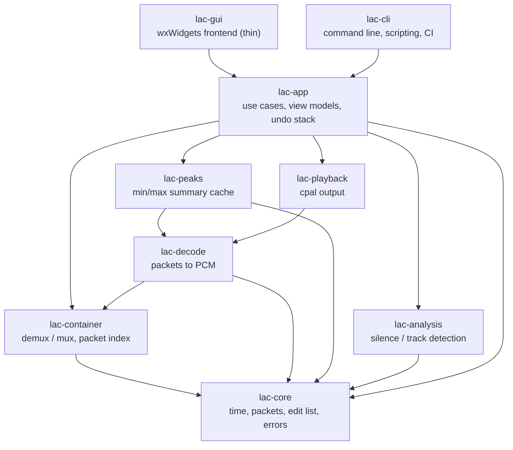
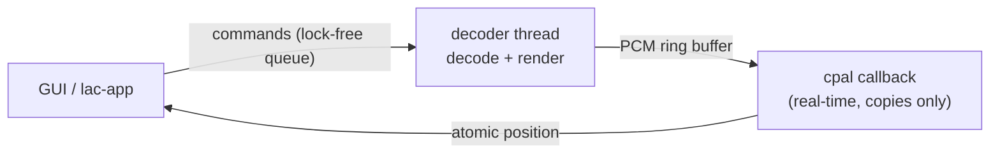

# losslessaudiocut: Architecture Proposal

Status: **draft for discussion**. Open questions are collected in
[section 12](#12-open-questions) and decisions so far in [section 11](#11-decisions-so-far); decisions marked *(proposed)* are
recommendations that still need a yes/no.

## 1. Goals and non-goals

**Goals**

1. Cut recordings in AAC, Speex, Ogg (Vorbis/Opus), MP3, WAV and FLAC
   **without re-encoding lossy audio**. Kept audio is bit-identical to the
   source after decoding.
2. Fast waveform display at every zoom level, from the whole multi-hour
   recording down to individual samples.
3. Playback with a cursor, so cut points can be found by ear.
4. A maintainable, layered architecture where each layer is testable without
   the layers above it, in particular without a GUI.
5. *(Future)* Automatic detection of regions with neither speech nor music
   (candidates for deletion) and of track boundaries (candidates for splits).

**Non-goals (for now)**

- Mixing, effects, gain changes, sample-rate conversion. Anything that
  modifies samples forces a re-encode, which contradicts goal 1.
- Multitrack editing in the DAW sense.

## 2. The central insight: cut packets, not samples

Every supported format stores audio as a sequence of **packets** (MP3/AAC
frames, Vorbis/Opus/Speex packets, FLAC frames, or for WAV arbitrary blocks of
PCM). A lossless cut is a cut that copies whole packets verbatim into a new
container. The hard part is not the copying but three per-codec subtleties:

| Issue | Meaning | Affected codecs |
|---|---|---|
| **Granularity** | A packet is the smallest unit we can keep or drop. | all lossy: MP3 1152, AAC 1024, Vorbis 64..8192 (variable), Opus 120..2880, Speex 160/320/640 samples |
| **Pre-roll / dependency** | A packet cannot be decoded correctly without its predecessor(s) (MDCT overlap, MP3 bit reservoir, LPC state). We must keep N extra packets in front of a cut and tell the decoder to discard their output. | MP3 (bit reservoir, up to ~511 bytes back), AAC, Vorbis, Opus, Speex (state converges after a frame or two) |
| **Trimming metadata** | Some containers can say "decode these packets but drop the first *a* and last *b* samples". This turns packet-granular cuts into sample-exact cuts while still copying packets verbatim. | MP3 (LAME/Xing tag delay/padding), MP4/M4A (edit list `elst`), Ogg (granule positions, Opus `pre_skip`) |

FLAC and WAV are special: they are lossless codecs, so we can re-encode the
two boundary frames (FLAC) or just slice samples (WAV) and still be
**sample-exact and bit-exact**.

From this follows the key domain abstraction:

```rust
/// What a codec/container pair is able to do when cutting.
/// Determined once per opened file; drives UI snapping and export.
pub struct CutCapabilities {
    /// Smallest cut step without trimming metadata (in samples, may vary per packet).
    pub packet_granular: bool,
    /// Packets that must be kept before the first wanted packet.
    pub preroll_packets: u32,
    /// Container can express leading/trailing sample discard.
    pub can_trim_start: bool,
    pub can_trim_end: bool,
    /// Boundary packets may be re-encoded losslessly (FLAC, PCM).
    pub lossless_reencode: bool,
}
```

The UI shows where a cut will *really* land (snapped to packet boundaries
when needed) and export produces an **exactness report** (requested vs.
actual cut position per boundary), so there are no surprises.

## 3. Layered architecture

The project is a Cargo workspace. Arrows mean "depends on". No crate depends
on a crate above it; the GUI is the only crate that knows about wxWidgets.



| Crate | Responsibility | External deps *(proposed)* |
|---|---|---|
| `lac-core` | Integer time base (`SamplePos: u64`), `PacketInfo`, `PacketIndex`, `EditList`, `CutCapabilities`, error types. Pure data, no I/O. | none |
| `lac-container` | One demuxer and one muxer per container: WAV, FLAC native, MP3 elementary stream, ADTS, MP4/M4A, Ogg. Builds the packet index, copies packets, writes trimming metadata and per-track tags, recomputes CRCs, seek tables and headers. **This is the lossless heart and is written by us.** | `crc`, maybe `mp4-atom` for box parsing |
| `lac-decode` | Turns packets into interleaved `f32` PCM for playback, the waveform cache and analysis. Wraps FFmpeg's decoders (libavcodec only, not its demuxers): it is fed packets from *our* demuxer, so the packet index stays the single source of truth and waveform positions match cut positions exactly. Each container describes its stream as `DecodeSection`s (codec, extradata, packets, and the part of the decoder output that is timeline: encoder delay, pre-skip and padding removed); the tests check the result bit for bit against the `ffmpeg` tool *(implemented: whole-file decoding, and random access via `decode_range`: a fresh decoder starts a codec-specific pre-roll before the range and its output is placed by `DecodeSection::packet_ends`; bit-exact against the whole-file decode on all fixtures)*. `ffmpeg-next` links libavformat too, but its demuxers are never called. | `ffmpeg-next` |
| `lac-peaks` | Per-packet min/max/RMS summary, multi-level pyramid, optional on-disk cache. Built progressively from decoded samples and queryable while it grows (`PeakBuilder`, `PeakSummary::columns`) *(implemented; stored and loaded as versioned bytes by `PeakSummary::to_bytes`/`from_bytes`, the cache directory itself is `lac_app::peak_cache`)*. | none |
| `lac-playback` | Audio output, transport (play/pause/seek), scrubbing, position reporting for the cursor *(implemented: `Timeline` of kept ranges, `Engine` with decoder thread, `rtrb` ring buffer and generation-checked flushes, linear-interpolation rate and channel conversion, `Player` on the default `cpal` device; the decoder is supplied by `lac_app::playback` as a `PcmSource`, so this crate does not depend on FFmpeg. Grain-restart scrubbing: `scrub::Scrubber` plus 5 ms fades at every seek. Speed: `Speed` in percent steps, `stretch::Stretcher` (WSOLA) or varispeed through the converter's ratio)*. | `cpal` (directly, `rodio` is not needed), `rtrb`; later `rubato` for varispeed |
| `lac-analysis` | Suggestions where to cut: deletable pauses (quiet or only noise) and track starts, from per-frame level, spectral flatness and band spectrum (section 8). Fed decoded PCM like `lac-peaks`, so it does not depend on `lac-decode` and is tested on synthetic signals *(implemented: `FeatureExtractor`, `detect`; run from `lac_app::analysis_job::AnalysisJob` and `lac detect`)*. | `rustfft`; later: `webrtc-vad` or an ONNX model via `ort` |
| `lac-app` | Use cases (open, select, cut, split, edit track tags, undo, export, analyse) and view models. Knows nothing about wxWidgets, so all UI logic is unit-testable *(implemented so far: `Source` open/export, `waveform`, `detail`, `peak_job`, `peak_cache`, `editor` (selection, cursor, and `Edits` = deleted ranges, split points and track names on the source timeline, undone by snapshots), `export_job` (one file, or one per track, from one opened source) and `playback`. The editor keeps split points on the source timeline rather than an `EditList` of tracks: deleting across a split then shortens both tracks without moving the split, and a track is derived as its span minus the deletions. Per-track tags: `tag_edits::TagEdits` holds what the user changed; the editor keeps changes for all tracks and per track (keyed by the track's start, the title being the track's name), `track_list` is the track list's view model, `layout` the dockable panes' names and how a stored arrangement is restored, and an export applies a track's changes to the source's tags, numbering track files among the files written unless the user set the numbers)*. | none |
| `lac-gui` | wxWidgets windows, waveform widget, menus, key bindings. Renders view models, forwards user events *(implemented: waveform window with zoom and scroll, fed by `lac_app::peak_job::PeakJob` and `lac_app::waveform::WaveformView`; below one packet per pixel column it draws from samples decoded in the background by `lac_app::detail::DetailLoader`, as exact per-pixel min/max and, below one sample per pixel, as a polyline; suggested pauses and track starts from `lac_app::analysis_job::AnalysisJob`; mouse selection, delete/restore with undo and export through `lac_app::editor::Editor` and `lac_app::export_job::ExportJob` (also of just the selection, `export_job::selection_task`, a `Keep` request of its kept parts); deleted parts stay on the source timeline, shaded; a `wxGrid` track list under the waveform edits every track's tags in place, and its start and end times (typing one moves that track boundary, as long as the tracks keep their order; selecting or changing a time puts the cursor there); *View > Perspective* (Ctrl+1 to Ctrl+6) zooms to the selection's edges in context, ranges from `lac_app::perspective`; each track tinted behind the waveform and in its track list row, the tint and selection strengths set in *Edit > Settings* (colours from `lac_app::appearance`, the dialog in `lac-gui/src/settings.rs`: pages listed down the left side with icons, changes previewed live), track boundaries can be dragged in the waveform (`Editor::begin_moving_track_start` and friends: moved live, one undo step per drag), double-clicking a track selects it and zooms to it, right-clicking it opens its menu (zoom, play its ends, cursor or selection edges to its ends, join, merge the selected rows' tracks with `Editor::merge_tracks`, delete, restore; `lac_app::context_menu::track_list`); tooltips on the waveform name the mark or area under the pointer (selection edges, cursor, playhead, track boundaries, suggestions, deleted parts, ruler) with its time and the command that acts on it, texts from `lac_app::hover`; a right click on the waveform opens a menu of selection, playhead and pointer commands from `lac_app::context_menu` (a right-button press stays a click until the pointer moves or it is held 250 ms, then it scrubs); a time ruler drawn in the waveform window's bottom strip (ticks and labels from `lac_app::ruler`); the main frame is a `wxAuiManager`: waveform in the centre, toolbar, minimap (whole recording with the visible part framed and draggable, view model `lac_app::minimap`), position bar (selection start/end/length fields and play clock, view model `lac_app::positions`), track list and a log of the status bar's messages (`lac_app::log`) as dockable panes toggled from the View menu, their arrangement (AUI perspective) and the window size kept in the config store between runs; *File > Open recent* lists the last files opened, the list kept by `lac_app::recent_files` (wxdragon binds neither `wxFileHistory` nor the doc/view `wxDocManager`) and stored in the config store, with the pane names and the restoring of older stored layouts decided in `lac_app::layout`)*. | `wxdragon` |
| `lac-cli` | Same use cases without a GUI: `lac cut in.mp3 --keep 0:10-3:45 -o out.mp3`. Doubles as the integration-test driver. Generates its shell completions and manpages from the same definition. | `clap`, `clap_complete`, `clap_mangen` |

### Decoding with FFmpeg, cutting with our own code *(decided)*

Decoding and cutting have different requirements, so they use different code:

- **Decoding** (playback, waveform, analysis) uses FFmpeg's libavcodec. It
  covers every format we need, including Speex and Opus, which pure-Rust
  decoders and libsndfile (no AAC, no Speex) do not. Decoding output never
  ends up in an exported file, so it cannot cost quality.
- **Cutting** (demux, plan, mux, tags) is our own code. FFmpeg's stream copy
  is packet-granular, but its pre-roll and trimming handling differs per
  muxer and is hard to verify. The lossless guarantee is the product, so we
  own it and test it exhaustively.

The container formats involved are small and well specified (Ogg pages,
ADTS headers, MP3 frame headers, FLAC frames, RIFF, MP4 boxes). MP4 is the
largest; it only needs `ftyp`/`moov`/`mdat` with a single audio track.

Keeping FFmpeg behind the `lac-decode` interface means it can later be
replaced per codec (for example by Symphonia) without touching anything else.

## 4. Core data model

```rust
/// One compressed unit as found in the source file.
pub struct PacketInfo {
    pub byte_offset: u64,   // position of the payload in the source file
    pub byte_len: u32,
    pub first_sample: SamplePos, // presentation position after decoder delay
    pub n_samples: u32,
    pub flags: PacketFlags,      // e.g. `independent` (see section 13)
}

/// Immutable, built once per source file by the demuxer.
pub struct PacketIndex { packets: Vec<PacketInfo>, /* + stream params */ }

/// A kept region of a source, in samples (half-open interval).
pub struct Segment { pub source: SourceId, pub range: Range<SamplePos> }

/// One output file: an ordered list of kept segments plus its own tags.
pub struct Track { pub segments: Vec<Segment>, pub tags: Tags }

/// Non-destructive edit: the document is an ordered list of tracks.
/// Cutting, deleting and splitting only rewrite this list; the source file is
/// never modified. Undo/redo = keeping previous EditLists (they are small).
/// Deleting parts of one recording is simply the single-track case.
pub struct EditList { pub tracks: Vec<Track> }

/// Format-neutral metadata of one track. Mapped to each container's native
/// tag format by the muxer (see section 5).
pub struct Tags {
    pub title: Option<String>,
    pub artist: Option<String>,
    pub album: Option<String>,
    pub album_artist: Option<String>,
    pub track_number: Option<u32>,
    pub track_total: Option<u32>,
    pub date: Option<String>,
    pub genre: Option<String>,
    pub comment: Option<String>,
    /// Anything else found in the source, kept as key/value pairs.
    pub extra: Vec<(String, String)>,
}
```

*(implemented as above, without a `cover` field: an export never changes the
format, so each muxer copies the source's pictures and other binary tag data
(FLAC `PICTURE` blocks, ID3 `APIC` and other frames, Ogg
`METADATA_BLOCK_PICTURE` as an extra) itself. Editing covers is not planned
yet.)*

When a recording is split into tracks, every new track starts with the
source's tags, gets `track_number`/`track_total` filled in automatically, and
the user then edits the per-track fields (typically title) in a track list
next to the waveform.

Time is always an integer sample count at the source rate. Floating point
seconds only appear in the UI layer, so rounding can never shift a cut.

Export writes one file per `Track`. For each one it asks the format's
`CutPlanner` to map each segment boundary to packet ranges plus trim values, and hands the plan to the
muxer:

```rust
pub trait CutPlanner {
    fn plan(&self, index: &PacketIndex, seg: Range<SamplePos>) -> CutPlan;
}
pub struct CutPlan {
    pub packets: Range<usize>,  // includes pre-roll packets
    pub trim_start: u32,        // samples the decoder must drop at the start
    pub trim_end: u32,
    pub actual: Range<SamplePos>, // what the listener will really get
}
```

## 5. Per-format plan

| Format | Demux | Mux | Best exactness | Notes |
|---|---|---|---|---|
| WAV | RIFF chunks | RIFF, rewrite `data` size | sample-exact, bit-exact *(implemented)* | trivial; first milestone. A `data` size that is a placeholder, too large, or too small (stale checkpoint, low 32 bits of a > 4 GiB chunk: no chunk header follows) is replaced by the audio actually present, with a warning |
| AIFF / AIFF-C | IFF chunks (big-endian), `COMM` with 80-bit sample rate; AIFF-C types `NONE`, `twos`, `sowt`, `fl32`, `fl64`, `alaw`, `ulaw` | `COMM` copied with a new frame count, fresh `SSND` | sample-exact, bit-exact *(implemented)* | as WAV; a `COMM` frame count or `SSND` size of 0 or beyond the file is replaced by the audio present, with a warning |
| FLAC | frame sync + CRC-16 chaining (no decoding), STREAMINFO | copy frames with rewritten variable-block-size headers, re-encode boundary frames losslessly (FIXED predictor + Rice), fix STREAMINFO (total samples, block/frame sizes, MD5), drop SEEKTABLE/CUESHEET | sample-exact, bit-exact *(implemented)* | the small FLAC decoder/encoder lives in `lac-container`, since boundary frames must be rewritten there |
| MP3 | frame sync confirmed by the next frame, side info (`main_data_begin`, `part2_3_length`), Xing/Info + LAME tag (delay, padding) | **repack the bit reservoir**: every kept frame's main data bytes are laid out anew over the output slots with new `main_data_begin` (raising a frame's bitrate index where it does not fit, never re-encoding); one granule of pre-roll; new Xing/Info + LAME tag with delay/padding and both CRCs; ID3v2/ID3v1 copied | sample-exact and bit-exact at the file's start and end on gapless decoders (ffmpeg, mpg123), packet-granular at joins *(implemented)*; non-gapless players also play the pre-roll (≤ 2 frames) | trimming only at the file ends, see `CutCapabilities::trims_at_file_ends_only` |
| AAC (ADTS, raw `.aac`) | ADTS headers (ISO/IEC 14496-3 1.A.2), each confirmed by the next header with the same profile, rate and channels, or the end of the file; 1024 samples per frame; an ID3v2 tag in front is read; channel configuration 0 (layout in a PCE) and frames with several raw data blocks are refused | kept frames copied verbatim, headers and CRCs unchanged, after the source's ID3v2 tag or a new one | frame-granular (23 ms at 44.1 kHz), 1 pre-roll frame *(implemented)*; bit-exact except 1024 samples at the file's start (unless it is the source's) and after each join | ADTS has no trimming metadata, so the pre-roll frame is played, not hidden; the decoder gets the AudioSpecificConfig built from the header; a change of profile, rate or channels ends the stream with a warning; PNS is noted as for M4A |
| AAC (M4A) | ISO BMFF boxes; first audio track's sample table (`stsz`/`stz2`, `stco`/`co64`, `stsc`, `stts`); each AAC sample decodes to one frame (1024 samples); timeline from the first non-empty `elst` edit, else the `stts` sum | `ftyp` and `stsd` copied, new `moov` (one track, `elst`, `roll` sample group) before one `mdat` of verbatim samples; 2 frames of pre-roll plus the start trim hidden by `elst` media time, end trim by its duration and a shorter last `stts` | sample-exact at the file's start and end, packet-granular at joins (`trims_at_file_ends_only`) *(implemented)*; bit-exact except one frame after each join | ffmpeg 6.1 honours only the edit list's start and plays the last frame whole (ffmpeg 9 honours both ends); fragmented MP4 (`moof`) is refused; other tracks are dropped with a warning. Perceptual noise substitution decodes to different noise after any cut (see below) |
| ALAC (M4A) | as AAC (M4A); each sample decodes to its `stts` duration (4096 samples per frame from ffmpeg, the last one shorter) | as AAC (M4A), without pre-roll and with the end trim in the edit list only (an ALAC sample's duration is its real length) | sample-exact at the file's start and end, packet-granular (about 93 ms) but bit-exact at joins, since ALAC frames are independent *(implemented)* | sample-exact joins would need rewriting the boundary frames as uncompressed ALAC frames, which needs an ALAC decoder in `lac-container` like FLAC's (follow-up issue) |
| AC-3 (raw `.ac3`) | sync frames (`0x0B77`, A/52 5.3) confirmed by the next frame's sync word or their own `crc2`; 1536 samples per frame; an ID3v2 tag in front is read; E-AC-3 (`bsid` > 10) is refused | kept frames copied verbatim, after the source's ID3v2 tag or a new one | frame-granular (32 ms at 48 kHz), no pre-roll *(implemented)*; bit-exact except 256 samples at the file's start (unless it is the source's) and after each join | raw AC-3 cannot hide samples, so neither trimming nor pre-roll is possible; decoders must seed the dither generator per frame (libavcodec: `cons_noisegen`) for cuts to be bit-exact, see below; a change of channel layout or sample rate ends the stream with a warning |
| Ogg Vorbis | pages; timestamps from packet durations, granule positions ignored except a consistent end trim | new pages, copy headers, new serial, CRC; one chained stream per kept part, led by its predecessor packet as pre-roll; a kept end-trimmed last packet keeps its end trim | packet-granular, bit-exact including joins *(implemented)*; sample-exact via granule positions later | block size variable (64..8192) |
| Ogg Opus | as above; pre-skip from `OpusHead`; end trim from the final granule when the granules before it are consistent | as Vorbis, with at least 80 ms pre-roll hidden by a rewritten `pre_skip`; the start trim is added to `pre_skip`, the end trim lowers the final granule (RFC 7845 4.4) | **sample-exact at every cut**, including joins, since each kept part is its own chained stream *(implemented)*; bit-exact after a short convergence window at joins | ffmpeg plays a kept part that starts and ends inside the same packet too long (see below) |
| Speex | Ogg pages, Speex header | as Vorbis, but all kept parts of a link in one stream, no pre-roll | packet-granular (20 ms) *(implemented)*; bit-exact after convergence at joins | ffmpeg and speexdec do not handle chained Speex |
| Matroska / WebM Opus | EBML elements, `SimpleBlock`/`BlockGroup` frames (all lacing modes), unknown-size Segments and Clusters of live recordings; timeline from packet durations, codec delay from `CodecDelay` (or the `OpusHead` pre-skip), end trim from `DiscardPadding` on the last block; only the first audio track | one Opus track in a fresh file of the same `DocType`: SeekHead, Info, Tracks, Clusters of verbatim packets, Cues; ≥ 80 ms pre-roll plus the start trim hidden by `CodecDelay` and `OpusHead` pre-skip, end trim by `DiscardPadding` | sample-exact at the file's start and end, packet-granular at joins (`trims_at_file_ends_only`) *(implemented)*; bit-exact after a convergence window at joins | Matroska cannot drop leading samples in the middle of a track (ffmpeg ignores negative `DiscardPadding`), so joins have neither pre-roll nor chaining; video and other tracks are dropped with a warning |

### Tags per container

Tags live outside the audio packets, so rewriting them never touches audio.

Every container reads its source's tags into `Tags` (`Container::tags`), and
`Container::write_cut` takes the tags to write: `None` keeps the source's
tags (verbatim where the format allows), `Some` writes the given ones. The
shared tag formats live in `lac_container::tags` *(implemented for all
containers with a muxer; round-trip tests, ffprobe cross-checks and a fuzz
target)*.

| Container | Tag format written | Notes |
|---|---|---|
| MP3 | ID3v2.4 at the start (`TIT2`, `TPE1`, `TALB`, `TPE2`, `TRCK`, `TDRC`, `TCON`, `COMM`, `TXXX` for extras); the source's other frames (`APIC`, ...) are copied, except those a cut makes wrong (`TLEN`, `MLLT`, ...) | reads ID3v2.2-2.4 and ID3v1; with new tags no ID3v1 is written, without them both source tags are copied verbatim |
| AAC (ADTS) | ID3v2.4 in front of the stream, as for AC-3 *(implemented)* | not standardised: ffmpeg 6.1 reads it, ffmpeg 9 ignores it; without new tags the source's tag is copied verbatim |
| AAC (M4A) | `moov/udta/meta/ilst` (`©nam`, `©ART`, `©alb`, `aART`, `trkn`, `©day`, `©gen`, `©cmt`, `----` for extras); other items (`covr`, `gnre`, ...) copied verbatim | Apple's gapless info `----:iTunSMPB` is dropped, as it describes the source; chapters are not copied |
| AC-3 | ID3v2.4 in front of the stream, as for MP3 | not standardised: ffmpeg 6.1 reads it, ffmpeg 9 ignores it; without new tags the source's tag is copied verbatim |
| FLAC | `VORBIS_COMMENT` (in place of the source's); `PICTURE` blocks copied | an ID3v2 tag in front of the stream is read, and written as `VORBIS_COMMENT` if there is none |
| Ogg Vorbis / Opus / Speex | the comment header packet (`TITLE`, `ARTIST`, `ALBUM`, `ALBUMARTIST`, `TRACKNUMBER`, `TRACKTOTAL`, `DATE`, `GENRE`, `COMMENT`, extras such as `METADATA_BLOCK_PICTURE`) of every output stream | the header is re-paged, vendor string and Opus extension data kept; audio packets stay verbatim |
| Matroska / WebM | one `Tag` without targets, with `SimpleTag`s (`TITLE`, `ARTIST`, `ALBUM`, `ALBUM_ARTIST`, `PART_NUMBER`, `TOTAL_PARTS`, `DATE_RELEASED`, `GENRE`, `COMMENT`), and the title as `Info/Title` | as ffmpeg writes global tags; tags aimed at a track UID (ffmpeg's `DURATION`) are not read |
| AIFF / AIFF-C | text chunks `NAME`, `AUTH`, `ANNO`, `(c) ` plus an `ID3 ` chunk with everything, both before `SSND` | the text chunks win when reading; the copyright is kept as the extra `COPYRIGHT`. Markers and instrument chunks are not copied |
| WAV | `LIST/INFO` chunk (`INAM`, `IART`, `IPRD`, `ITRK`, `ICRD`, `IGNR`, `ICMT`) plus an `id3 ` chunk, both before `data` | INFO has no album artist or cover; ffprobe reads only INFO |

Milestone order *(agreed)*: WAV, FLAC, Ogg (Vorbis, Opus, Speex), MP3, then the GUI, then AAC/M4A and ADTS.
Matroska/WebM with Opus was added after the GUI on request (Opus as recorded by browsers, OBS and conferencing tools).

### Ogg with unreliable granule positions

Many Ogg recordings (especially radio/Icecast captures) contain **random or
inconsistent granule positions**: a large arbitrary start value, jumps,
values that go backwards, or garbage. Players cope because they mostly ignore
them, so we must too:

- The Ogg demuxer **never derives timestamps from granule positions**. Each
  packet's duration comes from the codec itself: Vorbis from the block-size
  flags of the current and previous packet (mode header), Opus from the TOC
  byte, Speex from frames-per-packet in the header. `first_sample` is the
  running sum of those durations.
- Granule positions are not used for timing *(implemented)*. The one
  exception is the **Vorbis and Opus end trim** (Vorbis I A.2, RFC 7845
  4.4) *(implemented)*: the final granule of a stream is honoured when the
  granule of the page before it equals the packet-derived sample count
  there exactly, so garbage granules can never shorten a stream. An export
  that keeps such an end-trimmed last packet writes the same trim into its
  own final granule. In chained files this applies to every link, so the
  encoder padding of a link is not played in the middle of the file
  (as libvorbisfile, opusfile and ffmpeg do). Speex end trims, and end
  trims after inconsistent granules, are not applied: the timeline may
  then be up to one page longer than what a granule-trusting player
  outputs.
- Export **always writes fresh, consistent granule positions** starting at
  zero, a new serial number and recomputed CRCs, so cut files are cleaner
  than the source.
- Radio captures are often **chained** (a new logical stream, with new
  headers, per song or metadata change). Each chain link is indexed
  separately and decoded with a fresh decoder *(implemented)*; a cut
  across a link boundary becomes one output stream per link. Tests check
  that a chained file decodes bit for bit like its links decoded as
  separate files. Each link boundary is offered as a suggested track
  start (`Container::chapters`, `lac_app::chapters`), shown and applied
  like the analysis' suggestions; splitting there gives the track the
  link's comment header tags where they differ from the file's (the first
  link's), and a detected start within 2 s of a link boundary is taken to
  be that boundary *(implemented, issue #47)*. Captured web radio can
  change its title, and so start a new link, every few seconds; Edit >
  Settings > Detection > Suggest chained streams as tracks (a remembered
  option) turns these suggestions off.
  All links must share codec, rate and channel count; other files are
  refused (open question, issue #46).
- Captures can start mid-stream or contain damaged pages from network
  dropouts. The demuxer resyncs on the next `OggS` capture pattern with a
  valid CRC, skips damaged pages and lists them in a load report instead of
  refusing the file.

### Join points inside a file

Deleting a part and joining the rest creates an **internal join**: the packet
after the gap is decoded right after the packet before the gap, not after its
real predecessor. For PCM and FLAC this is harmless (bit-exact). For lossy
codecs the decoder state at the join is wrong for one or two packets:

| Codec | Effect at an internal join | Mitigation |
|---|---|---|
| MP3 | first frame after the join may reference bit-reservoir bytes that are no longer there; its first granule overlaps with a foreign predecessor granule | the reservoir is repacked, so every frame gets exactly its own main data *(implemented)*; the remaining overlap/synthesis-filter transient lasts at most 1152 samples (one MPEG-1 frame, two MPEG-2 frames), checked by the tests. The source's first and last frame hold encoder delay and padding that only the LAME tag hides; if such a frame lands at a join, that hidden part (< 1152 samples) is played. The packet index records it (`PacketInfo::hidden_before`/`hidden_after`), and the plan and the exactness report state it (`CutPlan::padding_before`/`padding_after`) |
| AAC | MDCT overlap-add mixes the tails of two unrelated frames: a transient of one frame (~20 ms) | M4A and ADTS: none, parts are joined in one stream *(implemented)*; the tests require bit-exactness from one frame (1024 samples) after each join on. Bands coded with perceptual noise substitution (PNS, ISO/IEC 14496-3 4.6.13) are filled with noise from a random generator that libavcodec runs from the stream's start, so after any cut, the file's start included, they decode to other noise of the same spectral envelope; *Decided* (issue #72): the export report and `lac info` say so whenever the stream uses PNS (`mp4::aac` reads each frame's section codebooks), and the tests check what still holds: the PNS-free fixtures are bit-exact; on a PNS fixture, the forward MDCT of each long-window frame of a cut equals the source's frame spectrum outside the noise bands and has the same energy in each noise band (`lac-decode/tests/pns.rs`) |
| Vorbis | as AAC | each kept part becomes a **chained** logical stream that starts with its real predecessor packet, whose output a new stream discards: **no join window**, bit-exact *(implemented)*. Caveat: ffmpeg does not reset its Vorbis decoder at a chain boundary and plays one extra overlap (≤ 23 ms) per join; libvorbisfile-based players are exact |
| Opus | CELT/SILK prediction state | each kept part becomes a chained stream with ≥ 80 ms pre-roll hidden by `pre_skip` (RFC 7845 4.3) and both ends trimmed to the sample *(implemented)*. The output is bit-exact again once the decoder has converged; the window depends on the content, typically < 100 ms. Caveat: when a kept part starts and ends inside the same packet (a sliver shorter than one packet, ≤ 120 ms), ffmpeg drops the rest of the pre-skip as soon as the end-trimmed packet arrives and plays up to one packet too much. That includes a part that starts inside the source's own end-trimmed last packet. The file itself is correct per RFC 7845 |
| Opus in Matroska / WebM | as Ogg Opus | none: kept parts are joined in one stream without pre-roll, since Matroska has no way to hide samples at the start of an inner block *(implemented)*. On the speech-like fixtures the decoder usually becomes bit-identical again within 330 ms (36 measured joins, 10 ms SILK frames converge slowest), but one join after a single kept packet took about 410 ms, so bit-exactness is no fixed-time property here either (issue #54). *Decided*, as for Speex: within 400 ms after a join anything goes; from then on the difference stays below one 16-bit LSB (2^-15), and before the first join the output is bit-exact. The same ffmpeg caveat as for Ogg Opus applies when the whole output is one packet trimmed at both ends |
| AC-3 | the first of a frame's six blocks is overlapped with the last block of the previous frame (inverse MDCT, A/52 7.9.4.2): 256 samples (5 ms at 48 kHz) differ after a join, and at the file's start when it is not the source's | none, frames are joined as they are *(implemented)*; the tests require bit-exactness from 256 samples after each join on. Mantissas without bits are filled with dither (A/52 7.3.4) from a random generator; libavcodec runs it from the stream's start unless `cons_noisegen` seeds it from each frame's content, which `lac-decode` sets and the tests pass to ffmpeg. Players with a stream-wide generator decode the dither of a cut file to other noise of the same level. *Decided* (issue #76), as for AAC's PNS: the export report and `lac info` say so whenever a frame asks for dither (`dithflag`) |
| Speex | CELP predictor, pitch memory and the float synthesis-filter state | none: parts are joined within one stream *(implemented)*. The audible transient lasts about 200 ms; after that the float decoder state only decays geometrically (below 1e-6 after about 200 ms). It becomes *bit*-identical only when the content lets it, which on continuous signals may never happen, so bit-exact convergence is no fixed-time property for Speex (issue #17). *Decided*: within 400 ms after a join anything goes; from then on the difference stays below one 16-bit LSB (2^-15, Speex's native output resolution), and before the first join the output is bit-exact |

Tests use a speech-like fixture signal (syllables separated by 80 ms of
silence) and require the output to be bit-exact from 250 ms (Opus) after
each join point on; for Speex and Opus in Matroska, within 2^-15 from 400 ms
after a join on (see the table). A kept part shorter than the window does not end it: the window
counts from the join, across following contiguous parts.

On top of that, the editor **suggests join points in quiet packets** (it has
the per-packet RMS from the waveform cache), because most deletions remove
pauses, and a transient in near-silence is inaudible. The exactness report
lists every internal join and the samples that are not bit-identical.

## 6. Waveform display

### Rendering rule

Given `spp` = samples per pixel in the current zoom:

- `spp < ~1`: draw a **polyline** through the individual samples (plus sample
  dots when very close).
- `spp >= 1`: for every pixel column draw a **vertical line from min to max**
  of the samples covered by that column.

### Data sources per zoom range

| Zoom | Source | Cost |
|---|---|---|
| `spp` ≥ packet length | **Level 0 summary**: min/max per packet | O(pixels) |
| `spp` ≫ packet length (whole file on screen) | **Pyramid levels 1..n**: each level merges 16 entries of the level below | O(pixels) |
| `spp` < packet length | decode the visible packets on demand, LRU cache of decoded packets | O(visible samples) |

Because packet lengths differ per codec (and vary within Vorbis), levels are
indexed by packet number, not by time; a column maps to a packet range via
binary search on `first_sample`. Per entry we store `min`, `max` (as `i16`,
plenty for display) and `rms` (reused by silence detection) per channel.

Size estimate: a 3 h, 4-channel, 48 kHz AAC recording has ~506 000 packets,
i.e. ~12 MB for level 0 (6 bytes per channel per packet) and under 1 MB for all
higher levels.

### Multichannel display

Recordings have 1 to 4 channels (the code makes no assumption about the
maximum). Nothing in the summary or the renderer is stereo-specific:

- The summary stores one `(min, max, rms)` entry per channel per packet, in a
  channel-interleaved array so one packet's data is contiguous.
- The waveform widget draws one **lane per channel**, stacked vertically, with
  the channel name (from the container's channel layout, or "Ch 1..n") at the
  left. Lane height is the available height divided by the channel count.
- A "mixed" view option draws a single lane with the min of all channel mins
  and the max of all channel maxes, useful for finding cut points quickly on
  small screens.
- Selections and cuts always apply to all channels together: packets contain
  all channels, so cutting a single channel would require re-encoding.

### Building the cache

Opening a file demuxes the packet index immediately (fast, no decoding), then a
background thread decodes the file once and fills the summary front to back.
The display shows what is already available and refreshes progressively.

### Persistent cache *(decided)*

Decoding a multi-hour recording takes a while, so the summary is stored on
disk. To avoid littering the recording folders, it does **not** go next to the
recording but into the per-user cache directory, which the OS and cleanup
tools already treat as disposable:

| OS | Location (via the `directories` crate) |
|---|---|
| Linux | `$XDG_CACHE_HOME/losslessaudiocut`, default `~/.cache/losslessaudiocut` |
| macOS | `~/Library/Caches/<bundle id>` |
| Windows | `%LOCALAPPDATA%\losslessaudiocut\cache` |

- **Key**: hash of canonical path, file size and modification time, plus a
  hash of the first and last 64 kB. A changed or replaced file never gets a
  stale waveform; a moved file is simply re-analysed.
- **Format**: a small versioned binary file per recording (magic, format
  version, key, packet count, channel count, levels). A version mismatch
  means "rebuild", never an error.
- **Eviction**, so unused caches go away by themselves: on startup and
  after each new entry, delete entries whose source file no longer exists,
  entries not opened for 90 days, and then the least recently used entries
  until the total is below a size limit (default 1 GB). Both limits are
  settings, and there is a "clear cache" menu entry.
- The cache is purely an accelerator: deleting it at any time is safe.

*Implemented* in `lac_app::peak_cache` (entries in a `peaks` subdirectory
of the locations above), used by `PeakJob`; File → "Clear waveform cache" in
the GUI. The key's content hash is 64-bit FNV-1a, which is stable across Rust
versions; each entry stores its full key, so a hash collision is a miss.
The two limits are constructor parameters for now; a settings dialog does not
exist yet.

## 7. Playback

`lac-playback` decodes ahead into a ring buffer feeding a `cpal` stream. It
plays the **EditList**, not the source, so you hear the result of your cuts
(including the snapped positions) before exporting. Position is reported via
an atomic sample counter that the GUI polls on a timer to move the cursor.

*Implemented so far:* playback of the kept ranges as the user selected them,
decoded with `lac_decode::decode_range` in quarter-second chunks; a test
checks on FLAC, MP3, Opus and Vorbis that what reaches the audio callback is
bit for bit the decoded kept parts. Not yet heard: the snapping to packet
boundaries and the codec's own behaviour at joins (the export report states
both). Commands go through an `mpsc` channel to the decoder thread rather
than `rtrb`, since only the callback needs to be lock-free; seeks are
flushed as described below, with the flush raised by the decoder thread when
it takes the seek, so that no audio of the old position can follow it.
Device sample rate and channel count are adapted by linear interpolation
(listening only; equal formats pass through unchanged).

### Engine structure

Three parts, so that the real-time audio callback never blocks and the
interesting logic is testable without a sound card:



- **Commands** (`Play`, `Pause`, `Seek(pos)`, `Scrub { pos, velocity }`,
  `SetRate`) go through a lock-free single-producer/single-consumer queue
  (`rtrb`). Every command carries a generation number; audio already in the
  ring buffer from an older generation is dropped, so a seek takes effect
  within one callback period instead of after the whole buffer.
- The **decoder thread** turns the `EditList` timeline into PCM: it maps a
  timeline position to source packets, decodes from the needed pre-roll
  packet, and runs the result through a **render stage** (plain copy,
  grain crossfade, resampler or time-stretcher, see below). Decoded packets
  are kept in the same LRU cache that the zoomed-in waveform uses, so
  scrubbing back and forth over the same spot does not decode twice.
- The **cpal callback** only copies from the ring buffer and advances the
  position counter. Output latency is kept small (target below 30 ms) by
  sizing the ring buffer dynamically: large during normal playback, small
  while scrubbing.
- The render stage is a pure function `(commands, decoded audio) -> PCM`,
  so tests drive it with scripted mouse movements and inspect the output
  without any audio device.

### Scrubbing

Dragging the cursor while playback is active plays the audio around the
cursor, so one can find a spot by ear. There are several ways to do it; the
engine treats them as interchangeable `ScrubMode`s of the render stage:

| Mode | How it works | Good for | Cost |
|---|---|---|---|
| **Grain restart** (first implementation) | On every mouse move, but at most every ~40 ms, restart playback at the cursor and play a grain of normal-speed audio until the next restart. Grains are joined with a ~5 ms crossfade, so there are no clicks. A held mouse keeps playing normally from there. | finding a word or a note: you hear real, undistorted audio | trivial |
| **Varispeed ("tape")** | Playback speed and direction follow the mouse velocity, including reverse, with pitch changing like tape on a reel. Needs a resampler (`rubato`). | fast orientation by the "sound" of a passage, music | moderate |
| **Pitch-preserving scrub** | Like varispeed, but a time-stretcher (WSOLA for speech, a phase vocoder for music) keeps the pitch, so speech stays intelligible at 2-4x and when slowed down. | voice recordings, finding a word | higher, but fine for one stream |
| **Fast skim** | Not mouse-driven: play at a fixed 1.5-3x with pitch preserved, from a key or a button. | listening through hours of speech | as above |

Grain restart comes first because it is the simplest and proven. Varispeed
and pitch preservation reuse the same command and render structure and only
add a render step, so they can follow without changing the engine.

**Implemented so far:** grain restart. The GUI scrubs while the *right*
mouse button is held (dragged, or held for 250 ms: a quicker click opens the
waveform's menu instead), and, unless *Play > Scrub while selecting* is off,
while a selection is dragged with the left one (its moving edge; a plain
click stays silent, and the option is kept in wxWidgets' config store). `lac_playback::scrub::Scrubber`
turns pointer moves into seeks, at most one per 40 ms, and catches up with a
pointer that moved too soon from the GUI timer. Instead of a crossfade, the
engine fades the old audio out over 5 ms while a seek is pending and fades
the new audio in over 5 ms after it, at every seek; that removes the clicks
just as well and needs no second decoder. The first chunk after a seek is
50 ms long, so a grain starts sounding about as fast as the pointer moves.

### Playback speed

Normal playback has an adjustable speed, e.g. 0.5x to 3x in steps
(keyboard shortcuts plus a control in the transport bar), for listening
through long speech recordings faster or slowing down a passage to find an
exact cut point:

- By default the **pitch is preserved** with the same time-stretcher as
  pitch-preserving scrub (WSOLA, which keeps speech intelligible and is
  cheap). An option switches to plain varispeed (pitch follows speed).
- Speed is a `SetRate` command like any other, so it can change during
  playback without a gap. The position counter always reports *timeline*
  positions, so the cursor stays correct at any speed.
- Speed only affects listening. It is never applied to exported files.

**Implemented so far:** speeds from 0.5x to 3x in steps (Ctrl+Up/Down,
Ctrl+Shift+N for normal, a drop-down list next to Play in the toolbar,
*Play > Keep pitch*). The time-stretcher is our own
WSOLA (`lac_playback::stretch`, 30 ms Hann windows at 50 % overlap, the
window moved by up to a quarter window to the best cross-correlation,
searched coarse to fine); it needs no extra dependency. Varispeed needs no
resampler crate either: the existing linear converter gets the ratio
`in_rate * percent : out_rate * 100`, exact in integers. Instead of a
`SetRate` command that changes speed without a gap, a speed change is a
seek to the current position with the new speed (5 ms fade out and in):
the ring then never holds audio of two speeds, and the position stays
`base + played * in_rate * percent / (out_rate * 100)`, exactly. Normal
speed bypasses both stages, so it stays bit-exact.

Scrubbing works on the **timeline** (after edits), so you scrub through the
result of your cuts. Two details make it feel right:

- The visual cursor, the scrub position and the audible position are the
  same timeline position, so the waveform and what you hear never drift.
- Silence-aware help, once the analysis exists: optionally skip regions
  marked as silence during skim, and snap the scrub cursor to region
  boundaries when the mouse is released.

## 8. Silence and track detection

*Implemented* in `lac-analysis` (features and rules), `lac_app::analysis_job`
(background thread), `lac detect` (command line) and the GUI. The GUI
starts the analysis together with the waveform when a file is opened and,
once it is done, draws each suggested pause as a strip along the bottom
(teal: silence, amber: noise only) and each suggested track start as a tick
at the top. *Edit > Split at suggested track starts* applies the track
starts with `Editor::split_at_all`, *Edit > Delete suggested pauses* the
pauses with `Editor::delete_ranges`; each is one undo step.

### Features per frame

Decoded PCM (the mean of all channels) is cut into frames of one hop, the
power of two at or above 20 ms (1024 sample frames at 44.1/48 kHz). Per
frame:

| Feature | Definition | Tells apart |
|---|---|---|
| level | RMS of the frame's samples, dBFS | quiet from loud |
| spectral flatness | geometric / arithmetic mean of the power spectrum, 150 Hz to 6 kHz (Hann window of two hops) | noise (hiss, wind, murmur: about 0.56 for white noise) from voice and music (harmonics: below 0.1) |
| band spectrum | power in 16 log-spaced bands, 80 Hz to 12 kHz, half-dB steps | one piece of music from the next by timbre |
| chroma | share of the energy from 400 Hz to 5 kHz in each of the 12 pitch classes (octaves folded) | one piece from the next by key and harmony, when the instruments stay the same |

The flatness band stays below every codec's low-pass, whose empty bins
would otherwise make everything look tonal. "RMS of the FFT versus the
amplitude" is constant by Parseval's theorem; how *evenly* the energy is
spread is what flatness measures. Chroma starts at 400 Hz because below,
one FFT bin is wider than a semitone; low notes count through their
harmonics. A 3 h recording needs about 18 MB of features.

### Rules

1. **Thresholds adapt to the recording**: noise floor = 10th percentile of
   the frame levels (digital silence left out), loud = 95th percentile;
   quiet threshold a quarter of the way from floor to loud, at least 6 dB
   above the floor and never above −45 dBFS, so that a recording without
   pauses keeps its quiet passages.
2. **Classes**: quiet (at most the threshold), noise (up to 25 dB above it
   and either flat, with a smoothed flatness of at least 0.3, or steady,
   with a spectral flux below 1 dB per frame averaged over 1.5 s before or
   after the frame), content (everything else). Flatness is what finds a
   noisy pause, e.g. between songs of a live recording, whose level alone
   looks like content; flux finds hum and fans, which are tonal but never
   change. The flux of a frame is the mean change of the band spectrum
   since the previous frame, weighted by band energy so that near-empty
   bands do not count with their random fluctuation.
   **Voice activity**: a noise frame is content after all when it rises at
   least 9 dB above the quietest frame within 1 s before it *and* within
   1 s after it, i.e. a burst such as a whispered syllable. This is the
   local signal-to-noise test of energy-based voice activity detectors;
   needing a dip on both sides keeps a pause that just gets louder
   (applause starting) a pause.
3. **Regions**: pauses shorter than 0.5 s inside content are content,
   content shorter than 0.2 s between pauses (a click) is pause. Every
   remaining pause is a deletable region.
4. **Track starts**: after every pause of at least 2 s inside the
   recording, 0.25 s before the content resumes, if the 30 s before the
   pause and the 30 s after it are at least 70 % content (rain with a few
   loud drops, or a fan with someone briefly talking, is no sequence of
   tracks); and where the mean band spectrum of the 4 s before a frame
   differs from the 4 s after by at least 6 dB (spread of the per-band
   difference plus half its mean, so loudness alone counts half), with
   both windows at least 90 % content (a simple form of Foote's novelty,
   for gapless recordings). Bands more than 20 dB below the quiet
   threshold are not compared.
5. **Recurrence**: verse and chorus of one song differ as much as two
   songs, but they come back. A change of timbre only counts when the 4 s
   after it also differ by the threshold from every 4 s window in the
   60 s before it, and the 4 s before it from every window in the 60 s
   after it.
6. **Shortest track**: of two suggestions closer than 30 s, only the more
   confident one is kept (a pause wins a tie).
7. **Key changes** (off by default, `lac detect --key`): where the mean
   chroma of the two windows has a cosine distance of at least 0.25 (the
   same melody on both sides: below 0.08; a fifth apart: 0.3; a third:
   0.5), with the same recurrence test.

### Tuning on real recordings

The numbers above were tuned with a harness (not in the repository; it
decodes with the `ffmpeg` tool, keeps `Features::to_bytes` per recording
and re-runs `detect` with other parameters in seconds) on

- 30 h of music: 18 albums and 190 single songs (studio and live; rock,
  metal, punk, pop, electronic, spoken word) glued together into one
  recording per album or per ten songs, so the 404 track boundaries are
  known, once as they are and once with every song's leading and trailing
  silence (below −50 dBFS) cut off, as a gapless mix;
- 15 h of recordings without known tracks: talks and audio notes, a reception
  with speeches, two concerts, and 8.4 h of rain.

A suggestion counts as a hit within 15 s of a boundary (plus the quiet
around it): on a live album the track mark lies somewhere in the applause
and banter, the song itself starts later. With the earlier rules (no
recurrence test, no shortest track, no content share, key changes on) and
with the current ones:

| | boundaries found (as is / gapless) | false track starts per hour of music | track starts per hour of other recordings |
|---|---|---|---|
| earlier | 98 % / 99 % | 186 | 145 |
| current | 79 % / 72 % | 7 | 6.5 |

The audio notes now get no track starts at all, the rain 23 in 8.4 h
(earlier: 844). What is missed is mostly gapless live albums, where
crowd noise and banter join songs of the same band and sound. Further
knobs measured: a shortest pause of 1 s instead of 2 s finds 2 % more
boundaries but doubles the starts in talks; a timbre threshold of 5 dB
finds 4 % more at 10 false starts per hour; the key detector found no
boundary the timbre missed (recall 1 % lower with it, the same false
starts).

All numbers are `DetectParams` fields in seconds or dB, so a settings
dialog can expose them; re-running `detect` on kept `Features` takes
milliseconds. Positions are frame-granular (about 20 ms) and are snapped to
packets by the cut planner like any manual cut.

### Further features, not implemented yet

- A **speech/music label** for content (WebRTC VAD's spectral model, or
  4 Hz modulation energy of the envelope), e.g. to colour the regions lane.
- **MFCC** instead of the plain band spectrum, so that timbre is measured
  independently of pitch.
- A music/speech/noise classifier (small ONNX model via `ort`).
- Results as a separate lane below the waveform, where accepting a region
  deletes it.

## 9. Quality strategy

The strongest oracle we have is an equivalence check, like in hardware
verification:

> **decode(cut(file, range)) == decode(file)[actual_range]**, bit for bit.

For PCM and FLAC this holds exactly. For lossy codecs it holds for every
sample after the pre-roll has been discarded, because the decoder sees the same
packets in the same state. This gives:

- **Unit tests** per crate (parsers on hand-crafted byte buffers, planners on
  synthetic packet indexes).
- **Property tests** (`proptest`): random cut ranges on fixture files, check
  the equivalence above plus container validity.
- **Cross-checks** in CI: exported files are decoded with `ffmpeg` and
  `flac --test` as independent references, to catch cases where our decoder and
  our muxer agree with each other but not with the world.
- **Fixtures**: short (a few seconds) generated files per format, created by a
  script with `ffmpeg`/`sox`, small enough to commit.
- **GUI**: view models in `lac-app` are tested without wxWidgets; the GUI crate
  stays thin enough that a manual smoke test suffices.
- Doxygen-style `///` docs on all public items, `#![deny(missing_docs)]` in the
  library crates, `cargo doc` in CI, plus `clippy` and `rustfmt`.

## 10. Platforms and packaging *(decided: Linux, macOS, Windows)*

- **GUI**: `wxdragon`, which builds and statically links wxWidgets itself on
  all three platforms.
- **FFmpeg**: only the decoder libraries are needed (libavcodec, libavutil,
  libswresample). Linux uses the system packages; macOS and Windows bundles
  ship a minimal FFmpeg built with only the needed decoders (LGPL build, which
  also keeps the binaries small).
- **Audio output**: `cpal` (ALSA/PulseAudio/PipeWire, CoreAudio, WASAPI).
- **Dependencies**: a weekly `cargo update` (`.github/workflows/cargo-update.yml`,
  Saturdays) refreshes every crate in `Cargo.lock`, transitive ones included,
  as a PR that runs the full CI and merges itself when green, so security
  fixes reach the weekly builds. Dependabot handles major crate bumps and
  the GitHub Actions.
- **CI**: GitHub Actions matrix on `ubuntu-latest`, `macos-latest` and
  `windows-latest` for build and tests. Format equivalence tests run on all
  three, because endianness-independent parsing and path handling are exactly
  what breaks between platforms.
- **Logo**: one SVG, `packaging/icons/losslessaudiocut.svg` (a strip of film
  cut in two, with a waveform across the cut). The GUI embeds it as its window
  icon (`lac-gui/src/logo.rs`); the release packaging renders the `.ico`,
  `.icns` and Linux icons from it, and the snap uses it as its icon (a
  byte-identical copy in `snap/gui/`). It uses plain shapes only, because
  wxWidgets renders it with NanoSVG.
- Release packaging: a `vX.Y.Z` tag makes `.github/workflows/release.yml`
  build a zip and an Inno Setup installer for Windows (x64, arm64), a `.dmg`
  for macOS (arm64, x86_64) and an AppImage for Linux (x86_64, aarch64),
  smoke-test each and attach them to the GitHub release; see
  [`release.md`](release.md). FFmpeg's shared libraries are bundled with
  each package; wxWidgets is linked statically. Linux also has a snap
  (`snap/snapcraft.yaml`, built in CI and published weekly to edge and
  stable, see [`snap.md`](snap.md)); the release workflow starts its
  publishing right after a release.

## 11. Decisions so far

| Topic | Decision |
|---|---|
| Decoding | FFmpeg libavcodec, for playback, waveform and analysis only |
| Cutting | own demuxers, cut planners, muxers and tag writers |
| Containers | all of them: WAV, AIFF, FLAC, MP3, ADTS `.aac`, MP4/M4A, AC-3, Ogg Vorbis, Ogg Opus, Speex, Matroska/WebM Opus |
| Tags | per-track tags when splitting |
| Platforms | Linux, macOS, Windows |
| GUI binding | `wxdragon` |
| Recording length | up to several hours |
| Ogg timestamps | computed from packet durations; source granule positions are not trusted (radio captures contain random values) |
| Waveform cache | per-user cache directory with automatic eviction |
| Channels | 1 to 4 (no fixed limit in code), one lane per channel |
| Editing model | delete parts and join the rest into one file; split into tracks with own tags. Joining separate recordings is not planned. |
| Exactness | packet granularity first; sample-exact trimming metadata is a later, optional feature (the `CutPlan` fields exist from the start, set to 0) |
| Scrubbing | grain restart while dragging (~40 ms grains, 5 ms crossfade) first; varispeed and pitch-preserving scrub later as further render modes |
| Playback speed | adjustable (e.g. 0.5x-3x), pitch-preserving (WSOLA) by default, varispeed as option; listening only |
| Video | future extension, see section 13; the core model must not rule it out |

## 12. Open questions

1. **Output format**: always the same container as the input, or also
   rewrapping without re-encoding, e.g. ADTS `.aac` to `.m4a`? *(Proposed:
   same container by default, rewrapping as a later feature.)*
2. **Matroska/WebM** (`.mka`, `.webm`): also used by some recorders. Add to
   the format list later?

## 13. Future: lossless video cutting

Cutting camera and phone videos follows the same principle, with one
difference: in video the independent unit is not a packet but a **keyframe**
(an I/IDR frame), and phones often put only one keyframe every 1-2 seconds.
Lossless video cuts therefore work like this:

- A cut keeps whole **GOPs** (keyframe plus following frames). The start of a
  cut is snapped back to the previous keyframe.
- For frame-exact starts the container's **edit list** (`elst` in MP4/MOV,
  which is what phones and most cameras write) hides the extra frames in
  front of the cut point, exactly like audio pre-roll. Players that ignore
  edit lists show up to one GOP extra, which is the same trade-off as for
  audio trimming metadata.
- Audio in the same file is cut with the existing audio planner and aligned
  to the video cut.

To keep this possible without building it now, the core model follows three
rules from the start:

1. `PacketInfo` carries a `flags` field with an `independent` bit (keyframe /
   decodable without predecessors). For audio, the planner derives pre-roll
   from codec rules; for video it would search backwards for the previous
   independent packet.
2. Positions are stored per stream in that stream's own **time base**
   (a rational, e.g. 1/48000 for audio, 1/90000 for video). For audio-only
   files this is the sample rate, so the "integer sample count" rule above
   still holds.
3. The MP4 and (later) Matroska demuxers and muxers are written for
   **multiple tracks** from day one, even while only one audio track is used.

The waveform, playback and analysis stay audio-only; a video extension would
add a thumbnail strip lane and a preview window in `lac-gui`.
